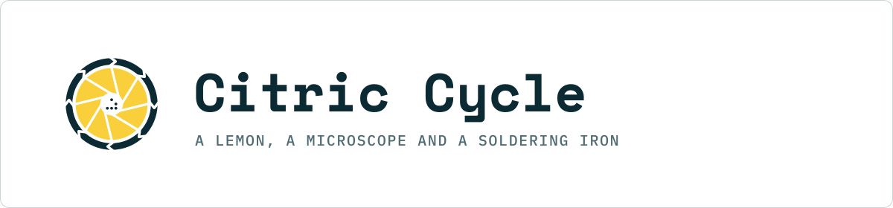

<!-- 43 69 74 72 69 63 20 43 79 63 6c 65 20 e2 80 94 20 6e 6f 74 68 69 6e 67 20 74 6f 20 64 6f 20 77 69 74 68 20 62 69 6b 65 73 2e -->

  <picture>
    <source media="(prefers-color-scheme: dark)" srcset="readme-header-dark.svg">
    
  </picture>

DIY science at academic depth: crystal growing, polarized-light microscopy, bench chemistry, and the electronics and code that make it repeatable. 
Every episode is a video; most come with an A4 write-up and a repository. <a href="https://youtube.com/@citriccycle">youtube.com/@citriccycle</a> · <a href="https://citriccycle.com">citriccycle.com</a>

## Episodes

| ID | Episode | Video | Write-up | Repository |
|---|---|---|---|---|
| 0x01 | Citric acid from lemons | in production | — | — |

## How a repository is laid out

Every episode repo follows the same shape: `README.md` (the short version), `writeup/` (the A4 PDF), `code/` (MIT), `data/` (CSV), `media/` (CC BY-NC 4.0). The brand assets live in [citriccycle/brand](https://github.com/citriccycle/brand).

## Licence

Text, figures and photos: [CC BY-NC 4.0](https://creativecommons.org/licenses/by-nc/4.0/). Code: MIT. Images uploaded to Wikimedia Commons are additionally CC BY-SA 4.0.

---

The cycle is the citric acid cycle. Nothing here has wheels.

